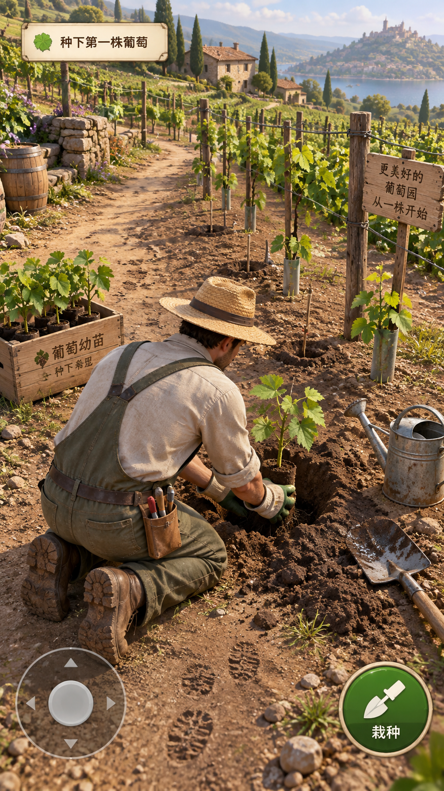

# 葡萄园小游戏：第三人称下地体验设计

日期：2026-10-12。用户已明确选择第三人称：看着自己的角色走进葡萄园、干活，获得真实种植的参与感。后续补充方向：内置多个人物供选择，以葡萄成长为闯关主线，将自然灾害和市场变化转化为关卡困难。

这份文件记录第三人称体验的设计方向。已有 Canvas 第一版保留地块经营界面；第三人称玩法另建原型。概念图用于说明视觉目标，实际游戏画面以运行版本为准。

后续实施更新：现已新增独立的第三人称三维演示，交付可选人物、七步定植和“雨前采收与交货”两章。完整八章及正式服务端关卡仍属规划；实际范围、运行方式与资源质量见 [下地闯关原型实现说明](VINEYARD_GAME_FIELD_IMPLEMENTATION.md)。

## 1. 当前版本为什么缺少吸引力

当前程序验证了种植和经营的规则，但玩家主要面对的是固定地块、数值、农事按钮和“推进 7 天”。

人没有进园，工具没有被拿起，操作缺少开始、过程和完成的反馈。玩家也很难看见“这根枝是我绑的”“这株苗是我种的”“这条水路是我修的”。真实的农艺因果关系因此没有转化成直观的参与感。

本版重新设计的核心体验是：走到一株葡萄旁，通过身体动作改变现场，再从现场变化理解种植结果。

## 2. 前五分钟：亲手栽下第一株葡萄

### 开园前选择人物

首批按四名成年人物规划，外形、年龄感和田间服装有所区别。选择界面可以转动预览人物，并观看走路、拿铲和浇水的短动作；确认后以该人物进入葡萄园。后续可在工具棚更换人物，农场、关卡进度和库存继续保留。

所有人物具有相同的行动与农事能力。角色外观用于建立代入感，通关取决于玩家的判断、操作和经营决策。人物共用兼容的骨骼与动作，逐个检查工具握持、蹲下栽苗及脚部接地。按所选人物加载资源，避免开园时同时加载全部高精度模型。

人物选择保存为独立的 characterId，服务端校验内置人物名单。旧用户第一次进入新场景时补选人物，不重建已有农场。

### 进入葡萄园

| 环节 | 玩家实际输入 | 画面与声音回应 | 决策或继续玩的理由 |
| --- | --- | --- | --- |
| 走进园子 | 左侧摇杆走动，拖动空白区域调整镜头 | 人物转身和迈步，碎石/土路脚步声，衣物与叶片轻响 | 园门、工具棚、苗木和水源是能走到的位置 |
| 取苗 | 靠近苗木，出现搬苗动作；点击抱起 | 双手拿起苗木或苗盆，人物改变姿态 | 把苗带到自己选定的位置 |
| 选地 | 观察向阳处、通道、水源和低洼水迹；确认位置 | 小范围标记栽植点，现场仍占据主要画面 | 种植位置影响日后管理便利及环境条件 |
| 挖坑 | 按住动作，释放可暂停或切换位置 | 人物挥铲，土块堆积，土坑逐步形成，铲土与碎土声音 | 工具、土壤和正在形成的坑使操作有重量 |
| 栽苗 | 将苗放入位置，拖动扶正，回填贴实 | 苗木倾斜与扶正，泥土包覆根区，表面留下新土痕 | 操作完成后能看见自己改变的地块 |
| 支撑 | 靠近支撑，拖动软绑带完成固定 | 手部动作与枝条轻微回弹，绑带留在场景中 | 玩家照料的是有结构的一株葡萄 |
| 浇定根水 | 到水源取水，再按住浇水；松开停止 | 水线落在根区，土色变深、形成湿润范围，水声随动作停止 | 观察供水是否足够；积水会提示暂停 |
| 留下名字 | 给苗木名牌命名，完成今日任务 | 名牌和栽植痕迹保存，镜头短暂展示前后变化 | 栽出第一行，观察自己命名的苗下一次长出什么 |

挖坑、回填和绑枝采用适量简化交互。长按只用于建立节奏，不将所有农事做成漫长的重复按键。初次体验强调完整过程，熟练后可以批量管理或使用设施。

选地、栽深、供水和支撑的具体正确做法，应根据真实园区、苗木与栽培方式审核；游戏不凭空设全国通用的厘米数或灌溉量。

## 3. 真实感的五个来源

### 身体在场

角色有走动、转向、蹲下、搬运、铲土、浇水、剪枝和提篮的动画。相机以人物背后略高的位置跟随，干活时自然靠近操作对象，完成后回到行走距离。

工具和对象需要接近才能操作。正在栽苗时，手里的苗会被放到土里，场景中不再另留一份相同物品。动画完成、物体状态变化和服务端确认要有明确的对应关系。

### 地方可信

首个园区只做一小块连贯空间：园门、工具棚、田间小路、几行葡萄架、水源、苗木和操作地块。角色走到这些位置，不能穿过树干、设施或围栏。

土壤、草、木桩、绳索和叶片有可辨认材质；日光、风、雨和遮阴影响现场观感。先保证这块小园子可走、可观察、可操作。

### 植物有结构

每株葡萄具备可辨认的主干、新梢、叶片、果穗和支撑关系。玩家靠近后能看到病斑、拥挤枝叶、果穗和损伤。

修剪时选定枝条，剪下后枝条真的消失；疏果时处理具体果穗，数量减少；采收时从架上摘下并装入篮子。后端仍可按管理单元计算，客户端以经过审核的规则把结果表现到植株上。

### 操作留下后果

浇水后根区土色和湿润范围变化；绑枝留下绑带；修剪改变冠层；种植留下苗木与名牌；采收留下空穗位和装满的篮子。

玩家理解问题的入口是现场：叶片状态、土壤湿润、阴影和病斑。详细水分或糖度通过检查工具查看，避免开屏就把所有指标铺满。

### 经营有期待

继续玩的理由来自自己的葡萄园：一株苗变成第一行，一行变成一片；第一张叶片、第一串果和第一次装箱是阶段目标。工具、灌溉和设施升级减轻已经体验过的劳动。

正常经营和探索管理方式都应获得回报。天气带来适量可应对的变化，避免频繁强制登录、无限刷动作或让单一固定操作成为每季唯一答案。

## 4. 从苗到成园的时间表达

葡萄为多年生植物，建园与达到充分结果需要时间。苗木定植、幼树培养与成园管理应区分，不能让玩家栽下的苗在几分钟内挂满成熟葡萄。可以保留阶段性的可观察变化，并通过明确标注的跨季或建园期时间跳转进入结果期。[OSU：Growing table grapes](https://extension.oregonstate.edu/catalog/ec-1639-growing-table-grapes)

初次五分钟的奖励是定植完成、现场变化、自己的名牌与下一目标。后续使用压缩的游戏日历，逐步出现萌芽、展叶、培养主干、上架和结果；这些阶段的时长按当地品种与生产记录校准。

新玩家从小规模建园教程开始。熟悉操作后，进入连续的成园经营，接入现有水分、负载、品质、库存和销售规则。

## 5. 成长章节与事件挑战

### 主线结构

玩家经营同一座持续保存的葡萄园，沿成长章节解锁工具、设施、地块和销售渠道。前两章属于建园与幼树培养；之后通过明确的年份、季节过场进入成园生产。章节切换继续使用已有植株和资产，采收后进入采后管理及下一季。

首批按八个章节规划，章节内拆成适合手机游玩的短任务。每个任务以约 3—8 分钟为体验目标，实际时长由试玩调整；完成任务不代表现实中的葡萄在几分钟内长成。

| 章节 | 玩家目标 | 可选困难 | 第三人称操作与决策 | 过关依据 |
| --- | --- | --- | --- | --- |
| 1. 种下第一株 | 完成定植与名牌，建立第一行 | 种植位置与水源距离、低洼地形、有限工具 | 走动选地、取苗、挖坑、栽植、支撑和浇水 | 定植流程完成，植株与位置正确保存 |
| 2. 把幼树养上架 | 观察生长，培养植株结构 | 供水不足、支撑松动、有限工时 | 巡园检查、补充供水、整理支撑并引导枝条 | 完成幼树阶段目标，进入明确标注的后续年份 |
| 3. 守住春天 | 在成园萌芽阶段安排管理 | 春季霜冻预警与防护预算 | 查看预报和植株，检查已有防护设施，预留应对资源 | 完成准备与检查；按应对和阶段恢复评价 |
| 4. 留好第一批果 | 完成开花坐果阶段管理 | 不同地块状态、负载与后续品质的取舍 | 近距离观察，完成引导、枝叶整理和适当留果 | 管理目标达到，能解释下一阶段的留果计划 |
| 5. 熬过炎热天气 | 维持果实生长和植株状态 | 干旱、高温、供水或设施预算约束 | 检查根区、叶片和果穗，安排供水与经审核的防护 | 在资源限制下保持阶段状态，控制可避免损失 |
| 6. 赶在雨前采收 | 判断哪些果达到采收条件 | 成熟期降雨风险、成熟不齐、收购报价变化 | 巡园检测、分批采收、处理排水、安排出货 | 合格采收与合理安排，不按未成熟果的数量奖励 |
| 7. 卖好第一批果 | 完成分级、包装和订单履约 | 收购价走低、需求变化、运输延迟、保鲜成本 | 提篮分级、包装装箱，比较批发、预订与零售方案 | 符合订单品质与期限，收入、成本和报损可追溯 |
| 8. 留住下一季 | 完成采后管理并规划扩园 | 维修费用、资金紧张、下一季需求不确定 | 检查植株与设施，维修、安排预算和下季规模 | 完成恢复及经营计划，保留资产进入下一季 |

表中困难是事件候选，不是每次进入章节必然发生的灾害。教程以正常天气建立操作信心；后续先引入单一风险，熟练后再安排少量复合挑战。相同章节可拥有正常年、干旱年或雨季等不同剧本，但事件需要符合生长阶段、产区、品种和设施条件。

农艺素材依据：春季萌芽后的新梢对霜冻敏感，成熟果遇雨可能出现裂果、落粒或腐烂，品种间风险不同；这些关系可用于关卡，但发生率、损伤曲线及措施需要当地生产经验校准。[OSU：Growing table grapes](https://extension.oregonstate.edu/catalog/ec-1639-growing-table-grapes)

鲜食品质同时涉及成熟度、硬度、裂果、腐烂及日灼等表现，采后商品寿命受品种、温度管理和腐烂敏感性影响。因此销售关应联系现场品质与保鲜条件，避免只有一个糖度数值。[UC Davis：Grape](https://postharvest.ucdavis.edu/produce-facts-sheets/grape)

### 一个具体关卡：雨前采收与交货

这是虚构的教学剧本。成熟期天气板提示下一个游戏日可能出现连续降雨，采购商给出当前报价，预订客户则要求指定品质和交货时间。玩家先走进园子，检查各行成熟情况和排水，再安排有限的工时、包装与运输资源。

可行方案包括先采已达标地块并快速出售，或投入已有防护、保留未成熟批次继续观察，并分批履约。已经采下的葡萄不会通过库存等待继续成熟；等待售出需要计入保鲜费用、报损风险及新的报价。游戏展示各方案的已知成本和风险范围，不承诺某个选择永远收益最高。[OSU：采收与成熟](https://extension.oregonstate.edu/catalog/ec-1639-growing-table-grapes)、[UC Davis：采后品质](https://postharvest.ucdavis.edu/produce-facts-sheets/grape)

操作反馈持续留在现场：排水通道疏通、被采下的果穗装入篮子、分级箱贴上标签、订单进入待发货状态。结算解释哪些品质损失来自天气、哪些来自采收判断或保鲜安排，再给下一阶段的补救目标。

### 让困难可理解、可应对

- 事件经历预警、准备、发生、结果和恢复。提供天气板、田间迹象或客户消息，并留出至少一次有意义的准备机会；预报表达不确定性，发生结果与预警范围一致。
- 每个风险配置适用阶段、触发条件、强度、预警窗口、已解锁的应对办法及恢复任务。先验证玩家能理解并使用措施，再允许事件进入对应关卡。
- 防护降低风险，已经造成的损伤保留，并通过阶段恢复或后续补救处理。避免点一次按钮就瞬间修复果穗或解除全部灾害。
- 市场困难使用虚构报价和需求剧本，公开品质要求、收购容量、交付期限、渠道成本及结算规则。预订按事先约定的条件履约，现货按展示的报价成交；不在玩家确认后暗中修改价格或订单条款。
- 普通过关评价包含必达任务和可选的品质、成本、应对目标，允许多种合理方案。低产季也可以靠合理减损和补救通关；过关不要求每次同时获得最高产量和最高利润。
- 普通失败保留人物、土地、设施和已完成章节，进入补救任务或下一季恢复。练习重试使用独立副本与固定剧本，不能把重试所得库存或奖励带回正式农场；首次通关奖励只发放一次。
- 关卡事件随玩家明确推进的游戏时间结算，正式关卡内的作物、库存、订单期限和天气使用同一时钟。离开游戏会暂停尚未处理的挑战窗口，既有离线补算在挑战模式下需调整；暂停期间也不产生额外收益，避免时间不同步导致报损、超期或免费生长。
- 具体操作和阈值按当地品种及栽培方式审核。关卡分数是游戏规则，不代表真实生产中的通用标准；不同外观人物面对相同条件、具有相同能力。

### 实现职责与存档

关卡配置记录章节编号、进入条件、目标、可用工具、事件剧本、过关判定和奖励。运行状态记录当前章节、目标进度、游戏时间、事件种子、已发出预警、玩家决策、待结算事件及奖励领取状态。

正式模式由服务器按版本和事件种子结算农艺、资源与市场结果，并在同一事务内更新进度及奖励。恢复游戏后继续同一事件，不重新抽取更有利天气；重复提交仍沿用现有动作编号防重。移动、镜头和动作演出继续由客户端即时处理。

这部分是完整八章的规划。新增原型已实现定植和雨前采收交货两章；其余章节及正式服务端事件结算仍待实现。原有第一版的天气、经营、库存与销售继续作为经营基础。

## 6. 技术实现方向

建议用支持微信小游戏发布的 3D 引擎组织角色、相机、碰撞、骨骼动画与场景，例如 Cocos Creator。官方文档提供 3D 场景、模型与动画能力及微信小游戏构建流程，具体资源和机型性能须原型验证。[Cocos Creator 3.8 手册](https://docs.cocos.com/creator/3.8/manual/zh/)、[微信小游戏发布说明](https://docs.cocos.com/creator/3.8/manual/zh/editor/publish/publish-wechatgame.html)

| 部分 | 具体职责 |
| --- | --- |
| 人物与相机 | 角色控制、摇杆、碰撞、转向、跟随和操作时的观察距离 |
| 人物选择 | 内置人物预览、选择、更换、按需加载及选择存档 |
| 交互系统 | 检测附近的苗木、土地、水源、支撑和工具；呈现当前可用动作 |
| 动画与效果 | 动作开始/暂停/完成，手部与工具附着、水线、湿土、枝条变化和音效 |
| 场景状态 | 种植点、植株阶段、名牌、绑枝、已剪枝及采收状态 |
| 农艺规则 | 判定动作、状态和可解释结果；将生长及损伤映射为可观察的变化 |
| 关卡与事件 | 章节目标、解锁、预警、应对窗口、恢复任务及过关判定 |
| 市场与订单 | 虚构行情、品质要求、渠道容量、履约、成本及报损结算 |
| 服务端 | 动作合法性、资源及库存、存档版本、幂等提交与正式结算 |

移动和镜头本地即时响应；关键种植与经营结果由服务器确认。长动作使用“开始交互 → 播放与操作 → 完成提交”的流程，网络失败保留原动作编号并提示待核实。不要将每一帧人物移动都写入数据库。

树木和地形以手机可承担的资源组织：共享基础模型和材质，生长使用阶段模型与少量局部变化，远处简化细节，灯光尽量预先烘焙。先用代表性手机验证帧率、内存、加载和热量，再决定园区规模；概念图的视觉细节不能视为实际性能承诺。

三维资源需要独立准备：有骨骼的角色和农事动画、葡萄苗/幼树/成园模型、棚架、工具、地形、贴图与音效。一张场景概念图不能替代这些可交互资源。

## 7. 接续现有第一版

已有 Go 服务、正式身份、存档防重、农艺规则、库存销售和测试可以继续使用。主要新投入是可选角色、空间、交互、动作表现、建园阶段以及关卡、事件和订单。

旧存档继续保留成园地块、经营币、设施和季节进度。新场景在现有葡萄园旁提供一块扩建区，让老玩家参与栽苗；不悄悄把已有农场重置成空地。

新增场景及植株状态采用新的规则/存档版本，提供显式迁移和回放样本。界面不自行伪造已经种下的苗；正式栽植成功与服务端记录一致。

## 8. 第一个可玩片段的验收

第一轮目标是人物选择、一块可进入的小园子和一株可定植的苗，完成取苗、选地、挖坑、栽植、固定、浇水和保存，作为第一章“种下第一株”的可玩片段。首批四个人物共用动作，在相同场景中验证操作表现。

- 玩家能预览、选择并更换内置人物，选择跨次进入保存，农场与章节进度不变。
- 玩家能通过移动找到目标，角色不穿过围栏或设施。
- 拿苗、挖土、种植和浇水有对应动作、接触位置、声音和现场变化。
- 动作中断可继续，不误扣资源或重复生成苗木。
- 浇水停止后水线立即停止，湿土与苗木状态保存。
- 关闭再打开后，栽下的苗、位置与名牌仍然存在。
- 第一章目标随实际农事操作更新，服务端确认完成后过关并解锁后续章节入口；重复提交不重复发奖。
- 未读说明的试玩者能说清自己做了什么、现场发生了什么，并主动想栽第二株或观察下一阶段。

第二个片段单独验证一个天气事件和一个销售难题，例如“雨前采收与交货”。验收重点是预警可理解、存在多种可行应对、损失原因可解释、可补救，以及关闭游戏后挑战窗口和结算保持一致。第一轮不承诺一次实现全部八章。

## 概念图说明

概念图通过内置 image_gen 工具生成，属于下一版视觉方向示意，尚未实现为三维场景。图中的环境、美术细节和画质不是已确定的实际产区或手机运行效果。完整原始提示词保存于 [生成提示词](design/vineyard-third-person-prompt.txt)，下文为中文说明。

提示词：

“竖屏手机农场生活游戏的第三人称 3D 场景概念图。镜头位于人物身后略高位置，成年人穿朴素田间工作服、戴草帽，正蹲下把一株真正的葡萄幼苗放进土坑。小型葡萄园里有可走的田间路径、葡萄支架、未完成的栽植点、苗木和浇水工具。地面有泥土、碎石、脚印和一小片湿润土壤，苗木根区和手部接触清晰。自然日光，真实比例、可辨认材质、精致但适合移动游戏的三维美术。主画面用于走动和干活，界面只保留种下第一株葡萄的任务提示、半透明摇杆和当前工具动作。幼苗没有成熟葡萄，不把场景画成经营仪表盘，不使用手机外框或摄影画面。中文任务文字为‘种下第一株葡萄’，动作文字为‘栽种’。这是概念示意，呈现个人下地种植的参与感。”
